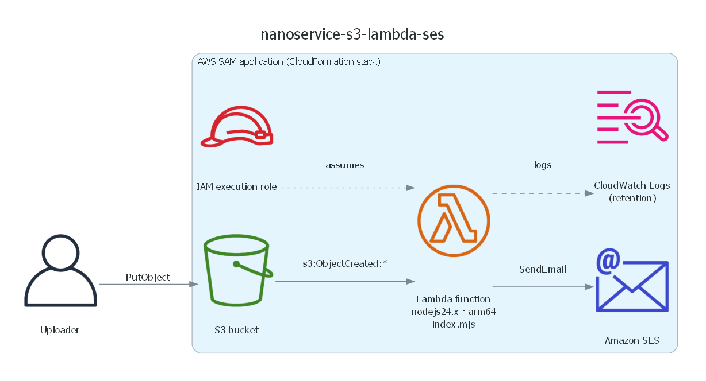

# Serverless nanoservice using S3, Lambda, and SES



Start up:

- Deploy application, specifying sender and receiver email address (the sender must be an SES verified identity; while your account is in the SES sandbox, the receiver must be verified too)

Test:

- Go to S3, bucket (see `BucketName` stack output), and upload file
- Go to email client and view email

Or with the AWS CLI:

```
aws s3 cp <file> s3://<bucket>/
```

Tear down:

- Go to S3, bucket, and empty bucket
- Go to CloudFormation and delete application stack (this also deletes the CloudWatch log group)
